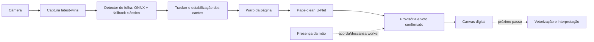

# Draw — estado do sistema e gargalos

**Atualizado em 2026-11-06.** Este mapa resume o estado do caminho de
captura, os defeitos de produto, o que foi medido e qual prova falta.
`docs/FALHAS.md` continua sendo a taxonomia detalhada; aqui, cada
afirmação é marcada como evidência, hipótese ou lacuna para não
confundir resultado de modelo com comportamento da mesa.

## O que o produto faz hoje

O repo entrega a camada 1 da visão: captura, retificação e tinta. CAD,
interpretação semântica e feedback de simulação continuam futuros. A
fronteira atual de qualidade é a fidelidade do canvas em movimento,
com mão, troca de página e correção, não a integração CAD.

## Modelos instalados e o que os números permitem concluir

| Componente | Em uso neste checkout | Estado que os dados sustentam |
|---|---|---|
| Folha | `draw_seg_v3_dyn.onnx`, SHA `e20a89f0` (fine-tune dinâmico 384) | Está instalado para teste ao vivo; não há prova comparativa temporal selada que justifique promovê-lo como melhor em todos os cenários. |
| Tinta | `page_clean_unet.onnx`, SHA `a470bd28` (w8) | Incumbente operacional. Traço fino fica no limite/reprovado pela régua estrita; a versão binária vaza impressão. |
| Tinta × impresso | corpo/candidato TRI de 3 classes | Treino e régua existem; nenhum candidato foi promovido ao caminho de produção. |

A escolha de modelos separados foi motivada pela interferência medida na
linhagem T7. A memória atual registra que a hipótese de um modelo único
(folha + tinta + mão) foi reaberta em 2026-11-06; portanto essa decisão
de arquitetura continua em avaliação. O Modelo C de folha tem cabeça
de presença e negativos difíceis; seu estado de execução no Kaggle não
foi reconfirmado nesta revisão. A anotação histórica de lançamento não
prova que ainda esteja treinando, nem há novo veredito aqui.

O registro de rollback em `FT_TEST_ROLLBACK.md` confirma que o detector
384 foi instalado para teste, com v3 original e fine-tune fixo 512
preservados. Nos 24 frames locais do diagnóstico `captures/diag-live/`,
uma inferência sequencial encontrou quadrilátero em 24/24 frames com o
384, 24/24 com o 512 e 20/24 com a v3 original. Medianas observadas
nesta VM: 48,6 ms, 86,4 ms e 46,9 ms, respectivamente. É evidência de
uma cena estática, pequena e compartilhada; não mede troca de folha,
balanço, cobertura pela mão, nem recall da máscara contra gabarito.
Portanto ela não decide o vencedor ao vivo.

Há uma tensão nos relatórios locais de sessão: as sessões com SHA
`e20a89f0` variam de 1,0% a 18,4% de `sheet_present`, enquanto duas
sessões longas com SHA `751e74da` registram 100%. O último relatório
(2026-11-06, 17 min) registra 8,8%, cinco quedas, 12,59 FPS e 53,8 ms
de detecção em média. `sheet_present` diz o que o tracker viu, não se
havia uma folha utilizável diante da câmera durante cada segundo. Isso
é um sinal para um replay A/B temporal controlado, não prova isolada de
regressão do modelo.

## Gargalos por prioridade

| Prioridade | Problema observável | Estado | Próxima prova que separa causas |
|---|---|---|---|
| 1 | Tradução dos dados reais em exemplos julgáveis | A memória atual registra dados brutos suficientes e uma esteira que sela sessões inteiras para treino/holdout. O primeiro lote citado tem 5 sessões/25 páginas de holdout em rascunho, 0 revisadas, e a maioria das sessões é de teste de câmera, não desenho. | Revisar os rótulos independentes do holdout e coletar sessões de desenho reais. Até haver holdout revisado, resultado de modelo não fecha decisão. |
| 2 | Identidade da página e queda/reentrada (F-09/F-11) | A versão de passada única escolhida como base é do Santleme; a alternativa da Julia, com herança julgada pelo voto e migração de âncora, ficou arquivada na worktree da VM. Na baseline com página real, a versão em `main` decide `new_page` em 16/16 retornos médios/longos da mesma página: recall ≥65% contra confirmado com halo compara níveis diferentes. | Tratar identidade em experimento separado. Para movimento sem drop, provar primeiro o portão de tremor desenhado em `docs/FALHAS.md`: a baseline soma +1.911 a +9.383 px dentro da geração. Não adicionar registro, que já está ativo, nem mudar produção antes do veredito. |
| 3 | Presença e geometria da folha em cena real (F-03/F-09) | Relatórios de sessão variam muito; não registram ground truth de quando a folha estava visível. O comparativo de 24 frames é estático. A memória registra que os modelos A/B noturnos falharam ausência real, apesar de um deles melhorar fundo hostil. | Um mesmo vídeo rotulado, executado nos hashes de detector; medir presença/ausência, erro dos quatro cantos, quedas e latência por regime. Julgar Modelo C contra esses casos antes de promover. |
| 4 | Traço fino, fantasma e impresso (F-02/F-05/F-06) | Há gates estáticos. W8 tem recall fino reportado em 0,40164 contra corte 0,402; o detector de tinta binário confunde impressão com tinta. TRI ainda não está promovido. | Candidato só avança se passar todos os gates no holdout real e depois no replay de cena; não otimizar IoU sozinho. |
| 5 | Mão sobre a página (F-03/F-04) | A presença da mão é assíncrona e controla a cadência/descanso. Na `main`, o page-clean recebe o warp sem máscara de visibilidade. Há relato de patch de oclusão em outra worktree, não integrado aqui. | Integrar e provar o ataque separadamente com mão nos pixels, não só booleano de presença. Medir perda, duplicação e atraso; não atribuir a ele a correção do recall F-11, que falha sem oclusão. |
| 6 | Apagar no papel (F-10) | Não implementado no acumulador page-clean, que só adiciona pixels confirmados. | Replay de traço desenhado e apagado, junto aos gates de fino e fantasma. |
| 7 | Latência percebida ponta a ponta (F-08) | Componentes têm telemetria. Nos relatórios recentes: ~12 FPS, detecção 44–54 ms, tinta 114–136 ms; não há medida caneta→pixel nem limite aprovado. | Carimbar quadro de entrada, confirmação e exibição no replay; separar fila de câmera, detector, warp, tinta e renderização. |

## Leitura do estado

- **F-01 — tinta repassada:** o usuário confirmou no teste de mesa que
  parou de repassar após PR #35. A regressão de registro por geometria
  tem replay de unidade. A reentrada de página era uma causa separada e
  tem mitigação sintética, mas falha em 16/16 retornos médios/longos
  na baseline com página real. Movimento sem drop é outra falha:
  cópia dentro da geração, apesar do registro ativo.
- **O modelo não está absolvido nem condenado:** as métricas de máscara
  apontam problemas reais de tinta; os frames estáticos favorecem a
  detecção do fine-tune atual; as sessões não têm rótulo de presença
  independente. Falta uma comparação temporal controlada.
- **O sistema está mais testado por peças do que como experiência:**
  voto, descanso, registro e workers têm bons testes isolados. Os
  maiores buracos restantes são sequências da aplicação com vídeo,
  identidade, mão e tempo real.
- **O limitador de avanço de modelo é a tradução/validação dos dados:**
  segundo a memória do projeto, as sessões já são gravadas e a
  separação treino/holdout por sessão existe; faltam rótulos
  independentes revisados e sessões de desenho representativas. O
  holdout em rascunho não é evidência de melhoria.
- **Velocidade não é o bloqueio principal agora:** ~12 FPS e passadas
  da ordem de 100–140 ms permitem trabalhar, mas não demonstram
  latência percebida boa nem confiabilidade de conteúdo. Corrigir
  identidade e medir presença/erro antes de gastar esforço em otimização.

## Sequência recomendada de trabalho

1. Completar a revisão do holdout independente e coletar sessões de
   desenho reais para que os próximos vereditos tenham alvo confiável.
2. Provar na régua o portão de tremor sem alterar produção e atacar o
   nível de comparação F-11 em experimento separado; depois fechar
   vídeo real e teste de mesa. A rodada com página real já foi feita.
3. Usar o mesmo vídeo rotulado para comparar hashes de detector e
   separar falha do modelo, tracker, câmera e regra de queda; incluir
   o Modelo C quando a avaliação estiver disponível.
4. Montar a régua de oclusão da mão e conectar uma máscara de
   visibilidade ao page-clean sem alterar o modelo antes de medir.
5. Definir suporte a apagamento e a régua conjunta de remoção, traço
   fino e fantasma.
6. Com conteúdo estável, fechar latência ponta a ponta e só então
   otimizar componentes que excedam o orçamento.

## Limites desta leitura

Os dados `captures/` são locais da mesa do Lucas e não formam um
holdout versionado. `sheet_present` e `mao_presente_pct` são saídas do
próprio sistema, não ground truth. Os scores de tinta e os limiares
citados vêm das réguas descritas em `docs/FALHAS.md` e `tools/judge.py`;
uma inferência sobre frames sem máscara rotulada não substitui esses
gates. A baseline com página real do draw-lab é medição de laboratório,
registrada em `docs/FALHAS.md`, não vídeo real nem aprovação na mesa.
